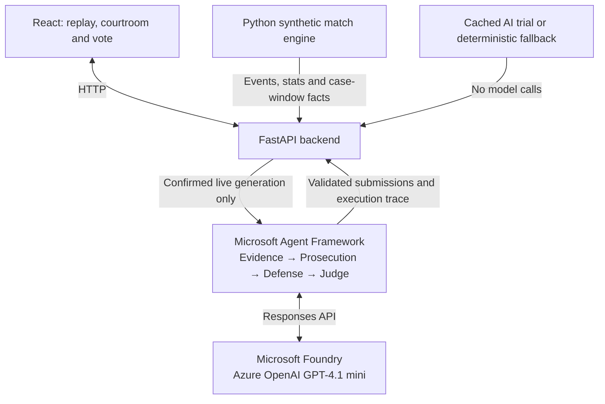

# Football Courtroom

**Every Moment Has Two Sides.**

I built Football Courtroom because the best football arguments rarely end with a stat or a replay. Was that a wasted chance, a real momentum shift, or just a convincing story after the fact? The idea was to turn those arguments into a courtroom: examine the evidence, hear both sides, make your own decision, then see how an AI judge weighs the same case.

The courtroom's AI uses **GPT-4.1 mini deployed in Microsoft Foundry**, with **Microsoft Agent Framework** coordinating Evidence, Prosecution, Defense and Judge. They select evidence, debate its meaning and explain a ruling. The Python simulator provides the facts; the agents supply the interpretation.

Built for the **Premier League × Microsoft Inside the Game hackathon**. The demo runs locally. All clubs, players and match events are fictional; there is no real match footage or live football data feed.

## What you can do

- Pick one of three reproducible matches, or generate a fresh synthetic match.
- Play, pause and seek through an event-based pitch replay, with match statistics and an event timeline.
- Open cases about missed opportunities, momentum shifts and substitution impact once their evidence window is complete.
- Follow five courtroom stages: **The Case → Evidence → Both Sides → Your Verdict → The Ruling**.
- Hear Prosecution and Defense, inspect their citations, and cast your own vote before the judge's ruling is revealed. Your vote stays independent of the AI's decision.
- Expand **Behind the verdict** to inspect actual agent handoffs and review cited events. Evidence replay stays inside the case window and doesn't move your original match replay position.

## How Microsoft AI powers the courtroom

I use **Microsoft Foundry's Azure OpenAI GPT-4.1 mini deployment** to generate the agents' reasoning and arguments through the Responses API. **Microsoft Agent Framework** builds the sequential workflow and passes validated submissions between its four roles:

- **Evidence Agent** reads verified match facts and incident records, selects up to three relevant facts, and explains their relevance.
- **Prosecution Agent** argues why the moment mattered using those facts.
- **Defense Agent** challenges Prosecution's argument with counterevidence, missing context or another reasonable interpretation.
- **Judge Agent** weighs both sides, explains its ruling and uncertainty, and can leave the case Inconclusive when the evidence is insufficient or balanced.

Agent Framework runs **Evidence → Prosecution → Defense → Judge** sequentially, passing validated work forward alongside the shared case evidence. Defense sees Prosecution's argument; the Judge receives both sides. Each agent's view stays within the same closed evidence window.

Python calculates exact facts and statistics and builds citations from authorized synthetic events. Agents select existing fact IDs and supply interpretations. Case-specific structured-output schemas and an independent grounding validator reject unknown references, future evidence and invalid submissions before each handoff. These checks reduce unsupported claims without guaranteeing that interpretations are right. If a stage fails, the pipeline stops and the courtroom uses recorded fallback.

In **Behind the verdict**, users can inspect actual execution status, handoffs and event citations. The Judge's reasoning remains sealed in the interface until they vote.

## From match facts to courtroom reasoning



The match engine is deterministic Python. Foundry generates the reasoning for explicitly approved live trials. React displays the result in the existing five-stage courtroom.

**One successful, validated four-agent trial** is included in `backend/data/courtroom-trials/`. It persists on disk and can be replayed without credentials or new Azure calls. Uncached cases use clearly labeled deterministic fallback when live AI is unavailable. For optional live generation, explicit confirmation, daily request limits, per-trial call limits, zero automatic retries and duplicate protection control usage. Navigation and rerenders never start generation.

The rest of the stack is **React + Vite** and SVG for the interface, and **Python + FastAPI** for the backend. The [workflow](backend/app/courtroom_workflow.py) uses Agent Framework's OpenAI provider and the official OpenAI Python SDK; versions are pinned in the [agent dependencies](backend/requirements-agents.txt).

## Run locally — no Azure account or charges needed

You'll need **Python 3.12** and **Node.js 22.12+**. From the cloned repository root:

```sh
python3.12 -m venv .venv/phase4b
.venv/phase4b/bin/python -m pip install -r backend/requirements-agents.txt
npm ci --prefix frontend

FOOTBALL_PUBLIC_MODE=true FOUNDRY_LIVE_ENABLED=false COURTROOM_LIVE_ENABLED=false \
  ./scripts/start-dev.sh
```

Open **http://localhost:5173**. Backend health is at **http://localhost:8000/health**. This mode serves the bundled AI result and deterministic fallback, with server-side live generation disabled. It needs no `.env` file or Azure credentials. Stop both services with:

```sh
./scripts/stop-dev.sh
```

To check interpreter selection without starting anything, run `./scripts/start-dev.sh --check`.

**Try the cached AI demo:** choose **Northbridge City vs Harbor Athletic** (`synthetic-303`), seek to **19:32**, open the missed-opportunity case and click **Begin trial**. You'll see the existing validated AI analysis, including all four agent handoffs, without another model request. The other matches still provide the complete courtroom experience through labeled fallback.

Newly generated matches live in the backend process and disappear when it restarts. Votes and replay positions belong to the current browser session.

## Optional: run live AI locally

Live generation is optional and can incur Azure charges. It requires your own compatible GPT-4.1 mini deployment and backend-only credentials. After stopping the default servers:

```sh
cp -n .env.example .env
```

Fill in `AZURE_OPENAI_ENDPOINT`, `AZURE_OPENAI_API_KEY` and `AZURE_OPENAI_DEPLOYMENT` locally. Use the resource endpoint, not a Foundry project URL; the backend appends `/openai/v1`. Keep credentials out of `VITE_*` variables, screenshots and Git.

Start the backend with process-only live permission, then run the frontend in a second terminal:

```sh
FOOTBALL_PUBLIC_MODE=false FOUNDRY_LIVE_ENABLED=true COURTROOM_LIVE_ENABLED=true \
  FOUNDRY_MAX_RETRIES=0 FOUNDRY_TIMEOUT_SECONDS=120 \
  .venv/phase4b/bin/python -m uvicorn app.main:app --app-dir backend \
  --env-file .env --host 127.0.0.1 --port 8000
```

```sh
npm run dev --prefix frontend
```

For an uncached, eligible case, **Begin trial** asks you to confirm the possible charge before generation. A complete trial uses at most four model calls, with zero automatic retries. Daily limits, persistent caching, duplicate protection and failed-case blocks remain active; don't clear private runtime records to retry a case. Cached results require no paid generation. Default startup does not load `.env`; the optional command above does so explicitly.

## Test without Azure requests

All AI tests use mocked responses. From the project root:

```sh
FOUNDRY_LIVE_ENABLED=false COURTROOM_LIVE_ENABLED=false \
  PYTHONPATH=backend .venv/phase4b/bin/python -m pytest -q backend/tests
npm test --prefix frontend
npm run lint --prefix frontend
npm run build --prefix frontend
```

Tests cover the simulator, replay synchronization, case eligibility, agent schemas and grounding, handoffs, caching, cost controls, voting and courtroom rendering.

Local secrets, virtual environments, build outputs and private `.logs/` records are ignored by Git. The bundled trial is a validated public artifact, separate from those private records. Optional Azure hosting templates are in `deploy/`; they have not been deployed and are not needed for this local demo or submission.
