# Phase 4B: grounded multi-agent courtroom backend

Phase 4B is backend only. The simulation, replay API and frontend courtroom are
unchanged. No live inference was used to implement or test this phase. The live
Phase 4A probe verified the deployment earlier; a four-agent live trial still
requires separate approval and has not been run.

## Runtime and framework compatibility

The optional [requirements-agents.txt](../backend/requirements-agents.txt) pins
`agent-framework-core==1.22.0` and `agent-framework-openai==1.17.0`, alongside the
existing `openai==2.48.0`. Agent Framework requires Python >=3.10. We verified the
actual installed signatures, request serialization, workflow and structured
outputs on Python 3.12.15. The current Responses provider is
`agent_framework.openai.OpenAIChatClient`, **not** the older
`OpenAIResponsesClient` import. Despite its name, it uses `/openai/v1/responses`.

To preserve an existing Python 3.9 `.venv`, install an additional environment
inside its ignored directory. Python 3.12 must first be installed locally:

```bash
python3.12 -m venv .venv/phase4b
.venv/phase4b/bin/python -m pip install -r backend/requirements-agents.txt
```

That separate environment was prepared for this implementation. Its interpreter
is `.venv/phase4b/bin/python`; the original `.venv/bin/python` remains intact.
Base startup, Phase 4A and deterministic fallback need only `requirements.txt`.
If the framework is missing, an opted-in trial safely reports
`framework_unavailable` without making a request.

Current official references, checked against the installed packages:

- [Microsoft: OpenAI Responses provider and current Python names](https://learn.microsoft.com/en-us/agent-framework/integrations/by-component/model-providers/openai)
- [Microsoft: typed workflow executors](https://learn.microsoft.com/en-us/agent-framework/concepts/workflows/executors)
- [Microsoft: structured agent outputs](https://learn.microsoft.com/en-us/agent-framework/agents/structured-outputs)
- [Microsoft: workflow state](https://learn.microsoft.com/en-us/agent-framework/concepts/workflows/state)
- [OpenAI: Structured Outputs](https://developers.openai.com/api/docs/guides/structured-outputs)

## Four distinct agents and explicit handoffs

```mermaid
flowchart LR
    R[Recorded events and eligible case] --> V[Server-verified evidence]
    V --> E[Evidence agent]
    E --> EV[Validate observations and references]
    EV --> P[Prosecution agent]
    P --> PV[Validate prosecution]
    PV --> D[Defense agent]
    D --> DV[Validate defense]
    DV --> J[Judge agent]
    J --> JV[Validate ruling]
    JV --> C[Cache successful trial]
```



`courtroom_workflow.py` constructs four framework `Agent` instances through
`OpenAIChatClient.as_agent`, each with separate role instructions and a typed
Pydantic output schema. All share the existing secure `AsyncOpenAI` adapter and
configured Foundry deployment. No new resources, tools or services are used.

A real `WorkflowBuilder` graph links four `Executor` subclasses. Each executor
invokes its agent, validates the result, and only then sends the typed
`TrialState` to the next executor. This is neither a single prompt with four
headings nor a replacement orchestration loop. The framework owns graph
dispatch and terminal output. Validated submissions are also recorded in
`WorkflowContext.state`.

| Stage | Input and responsibility | Validated output |
| --- | --- | --- |
| Evidence | Selected allegation, completed event window and authoritative fact catalog | Exact fact/value observations, event citations, a separate interpretation and uncertainty |
| Prosecution | Same verified evidence and Evidence submission | Strongest reasonable supporting interpretation with citations and uncertainty |
| Defense | Same evidence, Evidence submission and prosecution | Challenge assumptions, consider counterevidence and missing information |
| Judge | Same evidence and all validated submissions | Weigh both sides, cite findings, rule with explicit confidence and uncertainty |

Every agent receives the identical canonical evidence file. A defense cannot
silently substitute different observations. The trace records stage status,
input/output hashes and the explicit next recipient. Public contribution fields
contain only validated outputs; malformed or partial AI reasoning is discarded.

## Evidence boundaries and validation

`courtroom_evidence.py` reuses `detect_cases`, `select_replay_events`, and
`_window_summary`. A case must already be eligible at the request's replay
cursor. The server re-detects it at its fixed completed observation boundary,
selects both teams' events inside the relevant window, and builds facts from
those records. Later replay cursors do not expand the file or change its cache
identity. Match IDs, case IDs, seed, event IDs, completion times, team/player
identities, outcomes and available shot fields come from recorded data.

The server supplies the evidence file even in fallback mode. It never trusts
model-generated replacements for event records. It excludes full-match state,
future events, unrelated event metadata and detector counterclaims presented as
facts. Window statistics are freshly computed, including passing, shots, goals,
threat indicators and progressive actions. Inclusive window boundaries retain
the existing detector semantics; boundary events can appear in adjacent windows.

Structured Outputs constrain each response. Local validation additionally:

- Requires every field and rejects extra fields, malformed JSON, refusals,
  incomplete responses and tool output.
- Checks observation fact IDs and exact values against the computed catalog.
- Checks event citations against the bounded record and requires citations to
  belong to the facts they support. The Evidence agent must cite the trigger.
- Rejects numeric prose, common numeric spellings, invented structured statistics
  and explicit certainty markers. Quantities belong in verified facts, not prose.
- Requires the correct opposing stances, nonempty uncertainty, and a judge who
  explicitly leaves causation unestablished and the counterfactual unknown.

These checks verify provenance, structured quantities and temporal boundaries;
they cannot prove the semantic correctness of arbitrary natural-language
interpretations. All narrative stays labeled AI-generated reasoning. Confidence
is qualitative, limited to low/medium, and is not a calibrated probability.
Conservative prose validation may reject otherwise reasonable wording. Any
rejection returns an honest deterministic fallback rather than repairing output
with another charged call.

## API contract

`POST /api/matches/{match_id}/cases/{case_id}/courtroom`

Request (safe default, no inference):

```json
{"through_timestamp": 5400, "allow_live": false}
```

Use a case ID returned by `/api/matches/{match_id}/cases` at the same replay
cursor. Unknown matches/cases and cases not yet eligible return HTTP 404.
Invalid request fields return 422. Disabled/unavailable AI and generation
failures return HTTP 200 with `source: deterministic_fallback` and a sanitized
`error_category`; HTTP success is not evidence that AI ran.

| Response field | Meaning |
| --- | --- |
| `source` | `live_ai`, `cached_ai`, or `deterministic_fallback` |
| `disclosure` | Explicit attribution for this result |
| `evidence` | Server-verified case, seed, fixed bounds, events, fact catalog and limitations |
| `evidence_agent` | Validated AI observation selection; null in fallback |
| `prosecution`, `defense` | Stance, grounded interpretation points and uncertainty |
| `judge` | Result, findings, assessments of both sides, confidence and uncertainty |
| `trace` | Validated handoffs or the failed stage, hashes and sanitized categories |
| `api_attempts` | Physical model attempts reserved for this request, including network failures |
| `original_api_attempts` | Original generation attempts when serving cached AI |
| `http_status` | Last Azure status if available, otherwise null |
| `error_category` | Fixed category; never a provider body or exception message |
| `cache_key`, `configuration_version` | Opaque identity and implementation version |

Each grounded point has `interpretation`, `fact_ids` and `event_ids`. Every
observation is a `fact_id`/`value` pair that can be looked up in `evidence.facts`.
A ruling example (the surrounding response also includes the cited facts):

```json
{
  "result": "inconclusive",
  "findings": [{
    "interpretation": "The recorded incident warrants scrutiny, but its causal influence remains uncertain.",
    "fact_ids": ["trigger:EXAMPLE_EVENT_ID"],
    "event_ids": ["EXAMPLE_EVENT_ID"]
  }],
  "prosecution_assessment": "The prosecution offers a plausible reading of the incident.",
  "defense_assessment": "The defense reasonably identifies alternative explanations.",
  "confidence": "low",
  "uncertainty": "The synthetic records cannot establish a counterfactual outcome.",
  "causation_established": false,
  "counterfactual_outcome": "unknown"
}
```

The example event identifier is illustrative, not an accepted citation. Actual
IDs must come from the returned evidence. Fallback supplies deterministic
grounded arguments and an inconclusive ruling, explicitly disclosing that no AI
ruling is presented. Trace hashes do not expose raw failed provider output.

## Cost, opt-in and caching

No import, startup, simulation, GET route, or default POST request calls AI.
The server never automatically reads `.env`. Live trials require all of:

1. `FOUNDRY_LIVE_ENABLED=true` in the backend process.
2. `COURTROOM_LIVE_ENABLED=true` in the backend process.
3. An explicit `allow_live: true` request.

| Setting | Default | Effect |
| --- | --- | --- |
| `COURTROOM_LIVE_ENABLED` | false | Additional trial kill switch |
| `COURTROOM_MAX_MODEL_CALLS` | 4 | Hard per-trial limit, accepted range 0–4 |
| `COURTROOM_MAX_OUTPUT_TOKENS` | 256 | Additional per-call limit, range 16–256 |
| `COURTROOM_MAX_INPUT_BYTES` | 128000 | Complete serialized model request ceiling, range 1024–128000 |

The effective output cap is the **minimum** of the courtroom setting and
`FOUNDRY_MAX_OUTPUT_TOKENS` (which still defaults to 32 for the tiny Phase 4A
probe). A future approved trial should use 256 for the global cap in that
process. A small ceiling can truncate structured output and cause fallback;
the system does not silently raise it. The byte cap is a conservative input
size bound, not a tokenizer-exact monetary limit.

Every physical model attempt passes a request hook that rechecks switches,
configuration, route, deployment, tokens, tools and the existing
`DailyRequestBudget`. Reservations occur before sending; failed networking and
partially completed trials consume attempts. All SDK retries are disabled,
framework model iterations are bounded, and a second request for the same agent
is blocked even if accidentally requested by framework code. No tools, hosted
services, background responses, redirects or proxy environment settings are
enabled. TLS remains verified and Responses storage is disabled. Dependency
debug logging is suppressed to prevent request/header disclosure.

The ignored `.logs/courtroom/` directory stores private, atomic JSON cache
records and POSIX per-key lock files. Identity includes match, case, seed,
canonical evidence, deployment/resource, limits and implementation version.
Successful results persist across process restarts and return `cached_ai` with
zero new attempts. Live kill switches also apply to cache reads.

A nonblocking file lock prevents concurrent duplicate trials across local
processes sharing this directory. An in-progress record is written before any
call. Failures and cancellations leave a failed/incomplete record, so client
retries and process restarts cannot silently regenerate a partly charged trial.
A concurrent request returns `trial_in_progress`; a later request after failure
returns `previous_trial_failed_or_incomplete`. Investigate the original failure
before an operator explicitly authorizes removal of that trial's record. Do not
automatically delete records or reset the daily ledger. Bump the implementation
version when changing prompts, schemas or validation policy.

## Test without Azure charges

```bash
PYTHONPATH=backend .venv/phase4b/bin/python -m pytest -q backend/tests
```

The Phase 4B suite executes the real framework and SDK with fake credentials and
`httpx.MockTransport`. Real socket connections are explicitly forbidden. It
never reads `.env`; budgets and caches use temporary test directories. Coverage
includes ordered handoffs, shared state, structured request serialization,
grounding, future leakage, incomplete/invalid outputs, partial failure, call and
daily caps, duplicate calls, durable cache, concurrency, cancellation, kill
switches, API attribution and existing endpoint compatibility. Running the suite
with only the original environment skips the framework-specific module; use the
Python 3.12 environment for full verification.

To inspect a real response contract safely without running a server or AI:

```python
from fastapi.testclient import TestClient
from app.main import app

client = TestClient(app)
match_id = client.get('/api/matches').json()['matches'][0]['match_id']
case = client.get(f'/api/matches/{match_id}/cases?through_timestamp=5400').json()['cases'][0]
result = client.post(
    f"/api/matches/{match_id}/cases/{case['case_id']}/courtroom",
    json={'through_timestamp': 5400, 'allow_live': False},
).json()
assert result['source'] == 'deterministic_fallback'
assert result['api_attempts'] == 0
```

## Controlled live trial later

Do not run this during implementation or ordinary tests. After separate approval,
start a local backend process with the saved configuration explicitly loaded,
without editing `.env` or exposing credentials:

```bash
PYTHONPATH=backend .venv/phase4b/bin/python - <<'PY'
import os
from pathlib import Path
from dotenv import load_dotenv
import uvicorn

load_dotenv(Path.cwd() / '.env', override=False, interpolate=False)
os.environ['FOUNDRY_LIVE_ENABLED'] = 'true'
os.environ['COURTROOM_LIVE_ENABLED'] = 'true'
os.environ['FOUNDRY_MAX_RETRIES'] = '0'
os.environ['FOUNDRY_MAX_OUTPUT_TOKENS'] = '256'
os.environ['COURTROOM_MAX_MODEL_CALLS'] = '4'
uvicorn.run('app.main:app', host='127.0.0.1', port=8000)
PY
```

Submit exactly one POST for an eligible case with `allow_live: true`. A fresh
successful trial needs four model requests, unlike the single Phase 4A probe.
Do not poll by repeatedly submitting generation requests. Inspect source,
attempts, trace and sanitized errors; a failure stops the workflow immediately.
Stop this explicitly enabled process afterward. No live trial was run here.

## Limitations and Phase 4C

The local cache/ledger requires POSIX locking and a shared persistent local
filesystem; it is not a distributed billing control. Cache records have no
automatic eviction. The existing server-session lifetime of generated matches
is unchanged. This local demo endpoint has no authentication or public-service
rate limiting and should not be exposed as a publicly enabled billable service.
Natural-language correctness and a full live four-agent response remain
unverified. The tight token limit favors brief submissions and may need a later
explicitly reviewed increase for richer arguments.

Phase 4C should adapt this response to the existing `TrialPresentation` contract,
add explicit user-triggered trial loading and source/error/cache disclosure,
surface citations and validated handoffs, and retain replay cutoff, stale-response
guards, the paused return cursor and vote-before-ruling behavior. Never replace
the recorded event log with generated narrative. No frontend integration is
included in Phase 4B.
